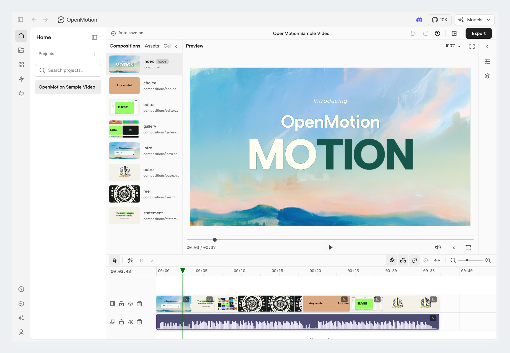
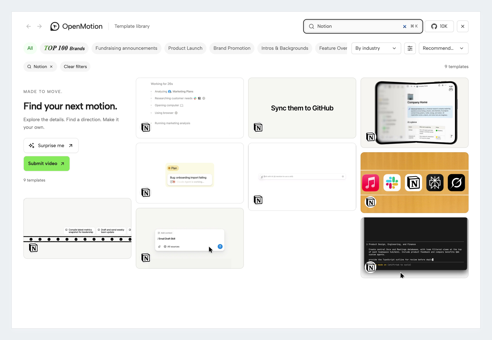
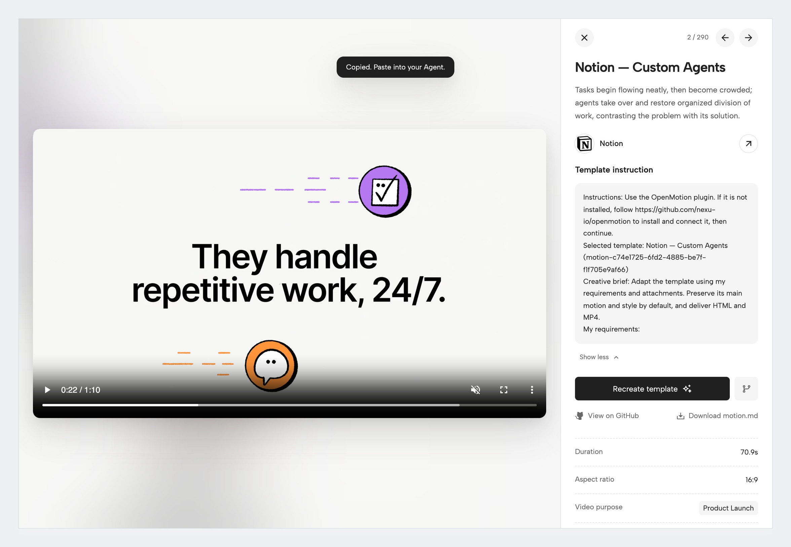

<p align="center"></p>

<p align="center"><strong>Giải pháp thay thế mã nguồn mở cho Claude Motion &amp; CapCut</strong></p>

<p align="center">
  <picture>
    <source type="image/webp" srcset="readme/capcut-claude-motion-cover.webp">
    <source media="(max-width: 600px)" srcset="https://releases.open-design.ai/open-motion/media/sha256/730e1d6235820d39ba8adde42810d1165377992136a3b20290ad5d504abb527b.jpg">
    
  </picture>
</p>

<p align="center">
  <a href="https://github.com/nexu-io/openmotion"></a>
  <a href="../package.json"></a>
  <a href="../LICENSE"></a>
  <a href="https://github.com/nexu-io/open-design"></a>
</p>

<p align="center">
  <a href="https://open-design.ai/motion/"></a>
  <a href="https://go.open-design.ai/?utm_source=github&amp;utm_medium=referral&amp;utm_campaign=openmotion&amp;utm_content=readme_vi"></a>
  <a href="https://discord.com/invite/M7NnHS9gNa"></a>
  <a href="https://applink.feishu.cn/client/chat/chatter/add_by_link?link_token=b6cs46dc-acb2-48ed-941d-c45642ead841"></a>
  <a href="https://x.com/OpenDesignHQ"></a>
  <a href="https://x.com/OpenDesignDevs"></a>
  <a href="https://www.youtube.com/channel/UChtshixMhvtgBWzoD9R_Qfg"></a>
</p>

<p align="center"><a href="#quick-start">Cài đặt</a> · <a href="#agent-wall">Các agent</a> · <a href="#showcase">Trường hợp sử dụng &amp; bản tái hiện</a> · <a href="#features">Vì sao chọn OpenMotion</a> · <a href="#technical-guide">Thiết lập & kiến trúc</a> · <a href="#community">Cộng đồng</a></p>

<div align="center">

[English](../README.md) · [简体中文](README.zh-CN.md) · [日本語](README.ja.md) · **Tiếng Việt**

</div>

# OpenMotion

OpenMotion là một studio **video agentic full-stack** và là **giải pháp thay thế mã nguồn mở cho Claude Motion và CapCut**. Tải lên một video tham chiếu hoặc dán liên kết video trên mạng xã hội để **tái hiện nó bằng bộ nhận diện thương hiệu (brand kit) và nội dung của riêng bạn**.

- 🎬 **Tái hiện video full-stack.** Lập trình video bằng HTML. Agent của bạn phân tích video tham chiếu, dựng lại các cảnh quay và hiệu ứng chuyển cảnh, đồng thời tạo các tài nguyên còn thiếu. Chỉnh sửa nhịp thời gian trong Studio và kết xuất thành MP4 từ cùng một dự án.
- 🔑 **BYOA — Mang theo Agent của bạn. BYOK — Mang theo Khóa của bạn.** OpenMotion miễn phí và mã nguồn mở. Tái hiện video trong [agent cục bộ của bạn](#agent-wall) bằng khóa API của riêng bạn. Các agent được hỗ trợ bao gồm Claude Code, Codex và WorkBuddy.
- 🧩 OpenMotion giới thiệu **Motion.md**, một định dạng Markdown ghi lại thứ tự cảnh quay, nhịp thời gian và hiệu ứng chuyển cảnh. Dùng nó để chia sẻ cách một bộ phim thương hiệu vận hành, theo từng cảnh quay.
- 🎛️ **Hình ảnh, video, âm nhạc và giọng nói.** Tạo hình ảnh bằng GPT Image 2.6, thêm một cảnh quay bằng Seedance 2.5, phối nhạc bằng Suno và thuyết minh bằng Eleven v4. [Khám phá các mô hình và nhà cung cấp](#model-wall).

<a id="快速开始"></a> <a id="quick-start"></a>

### Cài đặt từ ChatGPT Marketplace

**Cài đặt bằng một cú nhấp. Không cần cấu hình thủ công.** Sau khi cài đặt, bạn có thể tạo video chuyển động từ đầu, tái hiện video tham chiếu, hoặc bắt đầu từ một mẫu — tất cả ngay trong cuộc trò chuyện của bạn.

**[Cài đặt OpenMotion trong ChatGPT →](https://chatgpt.com/plugins/plugins_6a742d13e88481919b42002864b1bb26)**

<a id="start-in-codex"></a>

### Cài đặt trong agent của bạn

Cài đặt Skill chính bằng [Skills CLI](https://github.com/vercel-labs/skills):

```sh
npx skills add nexu-io/openmotion --skill openmotion
```

Sau đó hãy yêu cầu agent của bạn: **Dùng OpenMotion để cài đặt và kết nối Studio cục bộ cùng MCP, rồi giúp tôi làm một video.** Skill sẽ hoàn tất phần thiết lập từ mã nguồn ở dưới khi cần và tái sử dụng không gian làm việc hiện có. Việc cài đặt Skill đơn thuần chỉ sao chép các hướng dẫn; nó chưa cài đặt Studio hay kết nối MCP.

Sao chép chỉ dẫn này vào agent cục bộ của bạn để thiết lập OpenMotion từ mã nguồn:

```text
Read https://github.com/nexu-io/openmotion/blob/main/docs/install.md and follow the instructions to install and connect OpenMotion in the current agent.
```

Sau khi thiết lập, agent mở thư viện mẫu cục bộ và hiển thị phần chào mừng, tiếp theo là ba thẻ xem trước dự án trong một tài liệu HTML khép kín. Mỗi lần cài đặt lấy mẫu ba mục khác nhau từ nhóm bốn mục được tuyển chọn. Các bản xem trước im lặng hoàn chỉnh và ảnh poster được đóng gói sẵn, vì vậy phần hiển thị này không phải chờ MCP gốc tải lại hay tải các bộ phim tham chiếu từ xa. Tính năng phát lại bản tham chiếu gốc bằng MCP gốc vẫn có sẵn riêng và cần kết nối internet. Thư viện chỉ mở một lần bằng kết quả của công cụ mở, không kèm trang phụ hay bước kiểm tra phát lại nào. Lỗi khi mở sẽ được báo cáo kèm một liên kết dùng được và không làm mất hiệu lực của việc cài đặt. Việc kích hoạt MCP trong cuộc trò chuyện hiện tại được đánh giá độc lập. Hãy xem trước một thẻ, chọn **Recreate template**, rồi gửi bản tóm tắt yêu cầu của bạn để bắt đầu sáng tạo. [Hướng dẫn cài đặt từ mã nguồn](install.md) · [Lựa chọn trong phần chào mừng](install.md#maintained-recommendation-selection)

### Cài đặt ứng dụng npm đã phát hành (tùy chọn)

Thiết lập từ mã nguồn ở trên vẫn là mặc định cho việc cài đặt từ kho lưu trữ. Để chọn rõ ràng ứng dụng đã phát hành với Studio dựng sẵn và danh mục trực tuyến đã cấu hình của nó, hãy sao chép chỉ dẫn này vào agent cục bộ của bạn:

```text
Read https://releases.open-design.ai/motion and follow the instructions to install and connect the published npm application in the current agent.
```

[Cài đặt ứng dụng đã phát hành và lựa chọn kênh](install.md). Các phiên bản đã phát hành có thể chậm hơn bản sao này.

### Chạy kho lưu trữ trên máy cục bộ

Sử dụng Git, npm và Node.js 26.11.1:

```sh
git -c filter.lfs.process= -c filter.lfs.smudge= -c filter.lfs.required=false clone --depth 1 --single-branch --branch main https://github.com/nexu-io/openmotion.git
cd openmotion
npm ci
npm run build:studio
npm start
```

Mở `studioUrl` hoặc `previewUrl` thực tế được in ra khi khởi động, rồi chọn **Template library**. Studio và MCP đọc các mẫu trong bản sao này. Để kết nối agent của bạn với cùng bản sao đó, hãy làm theo [thiết lập từ mã nguồn và cấu hình MCP](#agent-setup). [Kích thước bản sao và media tùy chọn](repository-storage.md)


### Bắt đầu từ một dự án hiện có

Nhập một **tệp ZIP dự án HyperFrames** vào OpenMotion để tiếp tục chỉnh sửa bố cục và các tài nguyên cục bộ của nó. Nén thư mục dự án, mở **All projects → Import projects**, rồi chọn bản sao đã nhập để chỉnh sửa trong Studio hoặc bằng Agent của bạn. Việc nhập tạo ra một bản sao độc lập và yêu cầu cấu trúc dự án gốc được hỗ trợ.

[Hướng dẫn nhập từng bước, các tệp bắt buộc và tính tương thích](project-archives.md#import-from-hyperframes)

<a id="agent-wall"></a>

**22 agent cục bộ** · [Chọn agent của bạn](#choose-agent)

<p align="center"><a href="#choose-agent"><picture><source media="(max-width: 600px)" srcset="readme/agents/local-agents.mobile.png"></picture></a></p>

<a id="showcase"></a> <a id="brand-before-after"></a> <a id="what-can-you-make"></a>
<a id="use-cases-and-remake-examples"></a>

## 🎞️ Trường hợp sử dụng và ví dụ tái hiện

Khám phá các bản demo sản phẩm, phim thương hiệu, video người nói trước ống kính (talking-head) và nhiều hơn nữa. Các bản xem trước dưới đây hiển thị các video tham chiếu.

**[Duyệt toàn bộ thư viện mẫu →](https://open-design.ai/templates/)** — Tìm thêm mẫu, video đầy đủ, Motion.md và hướng dẫn tái hiện.

### Tái cắt & chỉnh sửa bằng AI

<table width="100%">
<tr>
<td width="50%" valign="top">
<picture><source media="(prefers-reduced-motion: reduce)" srcset="readme/live-templates/many-possible-futures.jpg"></picture><br>
<strong>OpenAI · Xây dựng một câu chuyện từ nhiều cảnh</strong><br>
Kết nối các cảnh khác nhau quanh một ý tưởng kể chuyện, rồi mở rộng thành một đoạn montage rộng hơn.<br>
<a href="https://open-design.ai/templates/many-possible-futures-motion-design/">Xem mẫu</a>
</td>
<td width="50%" valign="top">
<picture><source media="(prefers-reduced-motion: reduce)" srcset="readme/live-templates/making-of-window-collage.jpg"></picture><br>
<strong>Anthropic · Tái cắt một ảnh ghép hậu trường</strong><br>
Xếp lớp các clip và ảnh chụp màn hình theo trình tự, giữ tiêu đề chính dễ đọc ở phía trên chúng.<br>
<a href="https://open-design.ai/templates/making-of-window-collage-motion-design/">Xem mẫu</a>
</td>
</tr>
</table>

### Ra mắt sản phẩm & demo

<table width="100%">
<tr>
<td width="50%" valign="top">
<picture><source media="(prefers-reduced-motion: reduce)" srcset="readme/live-templates/notion-custom-agents.jpg"></picture><br>
<strong>Notion · Cho thấy một vấn đề, rồi đến giải pháp</strong><br>
Đi từ những nhiệm vụ chồng chất đến các agent phối hợp với nhau; điều chỉnh trình tự cho sản phẩm của riêng bạn.<br>
<a href="https://open-design.ai/templates/notion-custom-agents-motion-design/">Xem mẫu</a>
</td>
<td width="50%" valign="top">
<picture><source media="(prefers-reduced-motion: reduce)" srcset="https://releases.open-design.ai/open-motion/media/sha256/66bc3f14f916a58800562af5b2c8412b2f554f36a435da950faa39ef4b82da96.jpg"></picture><br>
<strong>OpenAI · Biến nhu cầu thành màn ra mắt sản phẩm</strong><br>
Tạo đà bằng các yêu cầu chồng lấp lên nhau, rồi tiết lộ ứng dụng trong một nhịp rõ ràng.<br>
<a href="https://open-design.ai/templates/demand-becomes-a-desktop-release-motion-design/">Xem mẫu</a>
</td>
</tr>
</table>

### Phim thương hiệu & chuyển động

<table width="100%">
<tr>
<td width="50%" valign="top">
<picture><source media="(prefers-reduced-motion: reduce)" srcset="readme/live-templates/a-world-connected-by-computational-fragments.jpg"></picture><br>
<strong>Kimi · Kết nối các thế giới bằng chuyển động</strong><br>
Dùng các dải mã, lát cắt lệch và hiệu ứng chuyển cảnh để kết nối một loạt cảnh thương hiệu.<br>
<a href="https://open-design.ai/templates/a-world-connected-by-computational-fragments-motion-design/">Xem mẫu</a>
</td>
<td width="50%" valign="top">
<picture><source media="(prefers-reduced-motion: reduce)" srcset="readme/live-templates/slack-slack.jpg"></picture><br>
<strong>Slack · Dựng lại một biểu trưng thương hiệu</strong><br>
Tách một biểu trưng thành các hình đơn giản và lắp ráp lại bằng màu sắc và tên của riêng bạn.<br>
<a href="https://open-design.ai/templates/slack-slack-motion-design/">Xem mẫu</a>
</td>
</tr>
</table>

### Giải thích & hướng dẫn

<table width="100%">
<tr>
<td width="50%" valign="top">
<picture><source media="(prefers-reduced-motion: reduce)" srcset="https://releases.open-design.ai/open-motion/media/sha256/79e74122a92470f1cfe4ce39552b1eacad81bf316514605fef8d64f0c62eea4b.jpg"></picture><br>
<strong>Anthropic · Giải thích một quy trình làm việc được kết nối</strong><br>
Theo dõi một câu hỏi xuyên qua dữ liệu, hành động và các slide, giữ cho ngữ cảnh luôn hiển thị.<br>
<a href="https://open-design.ai/templates/connected-tools-evidence-chain-motion-design/">Xem mẫu</a>
</td>
<td width="50%" valign="top">
<picture><source media="(prefers-reduced-motion: reduce)" srcset="readme/live-templates/an-agent-payment-with-human-approval.jpg"></picture><br>
<strong>Stripe · Trình bày một bước phê duyệt theo từng bước</strong><br>
Mang cùng một yêu cầu từ cuộc trò chuyện đến xác nhận trên điện thoại với sự liên tục hình ảnh rõ ràng.<br>
<a href="https://open-design.ai/templates/an-agent-payment-with-human-approval-motion-design/">Xem mẫu</a>
</td>
</tr>
</table>

### Câu chuyện dữ liệu & biểu đồ

<table width="100%">
<tr>
<td width="50%" valign="top">
<picture><source media="(prefers-reduced-motion: reduce)" srcset="readme/live-templates/mathematics-as-evolving-geometry.jpg"></picture><br>
<strong>OpenAI · Biến các ý tưởng phức tạp thành sơ đồ</strong><br>
Biến đổi một sơ đồ hình học thành sơ đồ tiếp theo bằng các điểm chung và đường nối.<br>
<a href="https://open-design.ai/templates/mathematics-as-evolving-geometry-motion-design/">Xem mẫu</a>
</td>
<td width="50%" valign="top">
<picture><source media="(prefers-reduced-motion: reduce)" srcset="https://releases.open-design.ai/open-motion/media/sha256/be5fc241ac81b90d7e7ded0bf1c90040d2823e6c659420d636722b5935c6e452.jpg"></picture><br>
<strong>Anthropic · Làm cho kết quả hiện dần theo từng bước</strong><br>
Đi từ cái nhìn tổng quan đến từng phát hiện riêng lẻ, rồi cho thấy hành động được thực hiện cho mỗi kết quả.<br>
<a href="https://open-design.ai/templates/scan-to-suggested-fix-motion-design/">Xem mẫu</a>
</td>
</tr>
</table>

### Hình ảnh âm nhạc & nghệ thuật

<table width="100%">
<tr>
<td width="50%" valign="top">
<picture><source media="(prefers-reduced-motion: reduce)" srcset="readme/live-templates/controllable-song-composition.jpg"></picture><br>
<strong>ElevenLabs · Trực quan hóa một bài hát đang thành hình</strong><br>
Kết nối prompt, các đoạn và nhịp độ với một dạng sóng và tác phẩm hoàn chỉnh.<br>
<a href="https://open-design.ai/templates/controllable-song-composition-motion-design/">Xem mẫu</a>
</td>
<td width="50%" valign="top">
<picture><source media="(prefers-reduced-motion: reduce)" srcset="readme/live-templates/living-waveform-poster.jpg"></picture><br>
<strong>Deezer · Tạo chuyển động cho một poster âm nhạc</strong><br>
Giữ tiêu đề ổn định trong khi những con sóng chảy thêm nhịp điệu xung quanh nó.<br>
<a href="https://open-design.ai/templates/living-waveform-poster-motion-design/">Xem mẫu</a>
</td>
</tr>
</table>

<a id="creator-video-gallery"></a> <a id="presenter-motion"></a>

### Biên tập video người nói bằng AI

Xây dựng một câu chuyện rõ ràng quanh một người nói, với phụ đề dễ đọc, các đoạn chèn màn hình và từ khóa chuyển động. Dùng các bản tham chiếu này để tìm một phong cách cho bản ghi của riêng bạn.

<table width="100%">
<tr><th colspan="3" align="left">🎓 Giảng dạy & giải thích</th></tr>
<tr>
<td width="33%" valign="top" align="center">
<picture><source media="(prefers-reduced-motion: reduce)" srcset="readme/people/careerwithriya.jpg"></picture><br>
<strong>6 essential skills to transform your career</strong><br>
Các điểm được đánh số + từ khóa chuyển động mạnh<br>
<sub>Tham chiếu · @careerwithriya</sub>
</td>
<td width="33%" valign="top" align="center">
<picture><source media="(prefers-reduced-motion: reduce)" srcset="readme/people/dan-martell-tools.jpg"></picture><br>
<strong>What's the best AI tool right now?</strong><br>
Người thuyết trình + các thẻ công cụ nổi<br>
<sub>Tham chiếu · Dan Martell</sub>
</td>
<td width="33%" valign="top" align="center">
<picture><source media="(prefers-reduced-motion: reduce)" srcset="readme/people/harpercarrollai.jpg"></picture><br>
<strong>10 Days of AI Basics, Day 1</strong><br>
Một bài học cá nhân + phụ đề dễ đọc<br>
<sub>Tham chiếu · @harpercarrollai</sub>
</td>
</tr>
<tr><th colspan="3" align="left">🖥️ Trình bày quy trình làm việc</th></tr>
<tr>
<td width="33%" valign="top" align="center">
<picture><source media="(prefers-reduced-motion: reduce)" srcset="readme/people/ali-abdaal-workflow.jpg"></picture><br>
<strong>5 tools I use every day</strong><br>
Câu chuyện bên bàn làm việc + các đoạn chèn quy trình<br>
<sub>Tham chiếu · Ali Abdaal</sub>
</td>
<td width="33%" valign="top" align="center">
<picture><source media="(prefers-reduced-motion: reduce)" srcset="readme/people/john-tagudin-capso.jpg"></picture><br>
<strong>Tool demo with callouts</strong><br>
Người thuyết trình + màn hình + chú thích<br>
<sub>Tham chiếu · @john.tagudin</sub>
</td>
<td width="33%" valign="top" align="center">
<picture><source media="(prefers-reduced-motion: reduce)" srcset="readme/people/aiwithsachi.jpg"></picture><br>
<strong>Top 5 plugins to install in Claude</strong><br>
Một danh sách được đọc lên + ảnh chụp màn hình hỗ trợ<br>
<sub>Tham chiếu · @aiwithsachi</sub>
</td>
</tr>
<tr><th colspan="3" align="left">🎬 Kể một câu chuyện, giới thiệu một sản phẩm</th></tr>
<tr>
<td width="33%" valign="top" align="center">
<picture><source media="(prefers-reduced-motion: reduce)" srcset="readme/people/khris-sheer-founder.jpg"></picture><br>
<strong>The Founder Experiments, Ep. 1</strong><br>
Nhật ký nhà sáng lập + B-roll đời thường<br>
<sub>Tham chiếu · @khris.sheer</sub>
</td>
<td width="33%" valign="top" align="center">
<picture><source media="(prefers-reduced-motion: reduce)" srcset="readme/people/ugc-rachelll.jpg"></picture><br>
<strong>AI creator with product</strong><br>
Câu chuyện sản phẩm + bằng chứng + hình trong hình<br>
<sub>Tham chiếu · @ugc.rachelll</sub>
</td>
<td width="33%" valign="top" align="center">
<picture><source media="(prefers-reduced-motion: reduce)" srcset="readme/people/kevinstratvert.jpg"></picture><br>
<strong>Stop Paying for 5 AI Tools</strong><br>
Hướng dẫn sản phẩm + trình diễn trực tiếp<br>
<sub>Tham chiếu · Kevin Stratvert</sub>
</td>
</tr>
</table>

<a id="features"></a>
<a id="why-openmotion"></a>

## ✨ Vì sao chọn OpenMotion

<a id="what-is-openmotion"></a> <a id="openmotion-是什么"></a> <a id="video-is-code"></a>

### 1. Một studio video agentic full-stack

**Lập trình video bằng HTML.** OpenMotion dùng HTML, CSS và JavaScript để mô tả các cảnh, kiểu chữ, bố cục, hiệu ứng chuyển cảnh và nhịp thời gian. Đoạn ghi hình, clip được tạo, hình ảnh, âm nhạc và lời thuyết minh trở thành media bên trong bố cục. Cùng một dự án mở được trong Studio và kết xuất thành MP4.


**Viết nó. Xem nó. Thay đổi nó. Kết xuất nó.** Hãy yêu cầu agent của bạn thay thế sản phẩm, thắt chặt đoạn mở đầu gây chú ý (hook), thêm một người thuyết trình, thay đổi phụ đề hoặc thử một cái kết khác. Nó chỉnh sửa mã nguồn dự án; bạn xem lại kết quả trong trình biên tập trực quan. Các máy khách MCP cục bộ dùng các công cụ dự án, trong khi các agent có quyền truy cập shell có thể làm theo quy trình Skills và CLI được ghim. [Thiết lập agent](#agent-setup) · [Hướng dẫn bố cục gốc](../skills/openmotion-production/references/native.md) · [Dự án HTML mẫu](../template-library/product-promo/index.html)

Nếu media lịch sử không khả dụng, việc khôi phục bằng Agent sẽ bị từ chối trước khi thay đổi dự án. Trình biên tập hiển thị một lỗi có thể đóng, kèm các đường dẫn tệp bị ảnh hưởng và xác nhận rằng dự án hiện tại không thay đổi.

<a id="studio-in-use"></a>



Xem lại video của bạn, sắp xếp các clip và xuất video từ cùng một không gian làm việc Studio.

#### Những gì bạn có thể thay đổi trong Studio

| Trong Studio | Những gì bạn có thể làm hôm nay |
| --- | --- |
| **Câu chuyện và dòng thời gian** | Nhập và sắp xếp media; nhờ agent cắt, sắp xếp lại và chỉnh sửa theo một kịch bản hoặc các mã thời gian đã xác nhận |
| **Chuyển động và phụ đề** | Tạo chữ chuyển động, hiệu ứng chuyển cảnh, chú thích, biểu đồ và phụ đề quanh nội dung của bạn |
| **Media và âm thanh** | Nhập tư liệu của bạn và tạo hình ảnh, video, âm nhạc và lời thuyết minh TTS thông qua các tích hợp mô hình có sẵn |
| **Chỉnh sửa hình ảnh** | Tạo các ứng viên bằng một mô hình hình ảnh có khả năng dùng bản tham chiếu và áp dụng một bản thay thế trong khi vẫn giữ nhịp thời gian và chuyển động |
| **Xem trước và các phiên bản** | Xem lại trong Studio, chỉnh sửa bằng tay hoặc bằng agent của bạn, và quay lại dự án cho lần chỉnh sửa tiếp theo |
| **Xuất và mã nguồn** | Kết xuất một phiên bản cố định thành MP4 và giữ lại HTML, CSS, JavaScript cùng media |

> “Giữ lại màn tiết lộ chúng ta đã duyệt. Thay cảnh giữa bằng bản ghi màn hình này, thắt chặt phần mở đầu bằng các mã thời gian này, và giữ CTA cuối cùng của chúng ta thêm hai giây nữa.”

[Các dự án và phiên bản](project-workspace.md)

<a id="share-an-editable-remake"></a>

#### Từ một clip tham chiếu đến một bản tái hiện có thể chỉnh sửa

1. **Phân tích bản tham chiếu.** Chọn một phân đoạn. Ghi lại thứ tự cảnh quay, hiệu ứng chuyển cảnh và các tín hiệu âm thanh của nó vào Motion.md, và đánh dấu những gì bạn muốn thay thế.
2. **Dựng lại các cảnh quay.** Agent của bạn dựng lại các cảnh HTML bằng brand kit, nội dung và hình ảnh của bạn, rồi sắp xếp chúng trên một dòng thời gian có thể chỉnh sửa trong Studio.
3. **So sánh các bản cắt.** Xem cùng một khoảnh khắc trong bản gốc và bản tái hiện. Điều chỉnh nhịp thời gian, chuyển động và âm thanh, rồi phát toàn bộ phân đoạn.
4. **Xuất và chia sẻ.** Kết xuất MP4 và giữ lại mã nguồn HTML cùng media. Để chia sẻ một dự án mà người khác có thể điều chỉnh, hãy kèm theo Motion.md của nó, một bản xem trước và các tài nguyên bạn có thể phân phối lại. [Danh sách kiểm tra đóng góp dự án](../library/ENTRY_TEMPLATE.md)

<a id="bring-your-agent-and-keys"></a>

### 2. Miễn phí và mã nguồn mở. Dùng agent cục bộ của bạn và mang theo khóa của riêng bạn.

<a id="choose-agent"></a>

**Chọn agent của bạn.** WorkBuddy, Codex, Claude Code và DeepSeek Harness có hướng dẫn cài đặt. Các nút khác mở phần thiết lập MCP và CLI dùng chung.

<p>
  <a href="#workbuddy-setup"></a>
  <a href="#agent-setup"></a>
  <a href="#claude-setup"></a>
  <a href="#local-agent-connection"></a>
  <a href="#local-agent-connection"></a>
  <a href="#local-agent-connection"></a>
  <a href="#local-agent-connection"></a>
  <a href="#local-agent-connection"></a>
  <a href="#local-agent-connection"></a>
  <a href="#local-agent-connection"></a>
  <a href="#local-agent-connection"></a>
  <a href="#local-agent-connection"></a>
  <a href="#local-agent-connection"></a>
  <a href="#local-agent-connection"></a>
  <a href="#local-agent-connection"></a>
  <a href="#local-agent-connection"></a>
  <a href="#local-agent-connection"></a>
  <a href="#deepseek-setup"></a>
  <a href="#local-agent-connection"></a>
  <a href="#local-agent-connection"></a>
  <a href="#local-agent-connection"></a>
  <a href="#local-agent-connection"></a>
</p>

| Mang theo… của bạn | Làm cho nó phục vụ video của bạn |
| --- | --- |
| **🤖 Agent — BYOA** | Kết nối agent cục bộ hiện có của bạn thông qua Skills và MCP, với quyền truy cập CLI ở nơi được hỗ trợ. Giữ nguyên máy khách, tài khoản và ngữ cảnh làm việc ưa thích của bạn. |
| **🔑 Khóa — BYOK** | Kết nối các khóa API của nhà cung cấp media được hỗ trợ trong Model Settings. Chọn mô hình cho hình ảnh, video, âm nhạc và TTS; các tích hợp media cục bộ được hỗ trợ có thể dùng thông tin đăng nhập agent hiện có của bạn. |
| **🎨 Thương hiệu và tư liệu** | Thêm logo, phông chữ, ảnh chụp màn hình, đoạn ghi hình bằng máy quay, kịch bản và âm nhạc của bạn. Giữ nhận diện và các tài nguyên đã phê duyệt trong phần Brand Kit của Motion.md. |
| **🧩 Tài nguyên khởi đầu** | Duyệt các bản tham chiếu, thành phần chuyển động, mẫu và Skills cộng đồng. Chọn một hướng đi, đưa mã nguồn hoặc bản tham chiếu cho agent của bạn, và biến nó thành của bạn. |

**Toàn bộ quy trình sáng tạo của OpenMotion là mã nguồn mở: Skills, các công cụ dự án, các tích hợp mô hình, Studio và việc kết xuất.** Chạy nó trên máy cục bộ, kiểm tra cách triển khai và mở rộng những phần bạn cần. OpenMotion không thu phí thuê bao phần mềm hay phí theo lần kết xuất cho quy trình cục bộ này. Bạn cũng có thể làm việc với đoạn ghi hình, hình ảnh và âm thanh của riêng mình mà không cần gọi các API tạo media.

Thông tin xác thực của nhà cung cấp ở trong không gian làm việc của bạn, tách biệt khỏi dự án video. Agent của bạn và các nhà cung cấp media tính phí mọi thuê bao hoặc mức sử dụng vào tài khoản của riêng bạn. [Thiết lập agent và tính tương thích](agent-adapters.md)

<a id="make-your-motion-language-reusable"></a> <a id="motion-design-community"></a>

### 3. Hơn 300 hướng dẫn Motion.md để tái hiện video

OpenMotion giới thiệu **Motion.md**: một định dạng Markdown ghi lại thứ tự cảnh quay, nhịp thời gian, hiệu ứng chuyển cảnh và các tài nguyên bạn có thể thay thế. Thư viện trực tuyến đưa các video tham chiếu và hướng dẫn chuyển động của chúng vào cùng một trang chi tiết.

Phần Brand Kit ghi lại nhận diện, giọng điệu và các thông tin sản phẩm đã phê duyệt của bạn; phần Design có thể tham chiếu một `DESIGN.md` độc lập cho các quy tắc hình ảnh. Giữ lại chuyển động và nhịp điệu của bản tham chiếu trong khi làm cho kết quả mang dấu ấn của riêng bạn.

Để chia sẻ một hệ thống theo ngành hoặc thương hiệu, hãy dùng [bản dự thảo Motion Package v0.2](motion-package-spec.md) và [bộ công cụ soạn thảo](../packages/motion-package/README.md). Một gói kết hợp các tài liệu thiết kế và chuyển động với tư liệu, các phụ thuộc đã khai báo và `SKILL.md` tùy chọn. Công thức đi kèm trình diễn hai preset nội dung; việc Studio tự động nhập và độ trung thực của bản kết xuất vẫn tách biệt khỏi việc kiểm định gói.


<a id="resources-to-start-from"></a> <a id="motion-gallery"></a>

#### Tìm một mẫu, rồi biến nó thành của bạn

Duyệt theo **thương hiệu tham chiếu, trường hợp sử dụng và loại video**, hoặc tìm kiếm một ý tưởng cụ thể. Một trang chi tiết mẫu tập hợp bản xem trước, phong cách hình ảnh, ghi chú sản xuất và tệp tải Motion.md. Chọn **Recreate template** trong Studio để sao chép một prompt cho agent của bạn.

Các mục chỉ có bản tham chiếu sẽ khởi đầu một quy trình tái cấu trúc. Khi mã nguồn có thể chỉnh sửa có sẵn, agent của bạn có thể điều chỉnh dự án trực tiếp.



[Duyệt thư viện mẫu](https://open-design.ai/templates/)

<a id="all-in-one-studio"></a> <a id="full-video-creation-stack"></a>

<a id="model-wall"></a>

### 4. Tạo nội dung đa phương thức: hình ảnh, video, âm nhạc và giọng nói

**BYOK biến các tài khoản đa phương thức của bạn thành một phần của quy trình làm video.** Thêm các khóa nhà cung cấp được hỗ trợ của bạn trong **Model Settings**, chọn mô hình của bạn, và tạo hình ảnh, video, âm nhạc và giọng nói thông qua **Model Gateway** của Studio. Xem trước các ứng viên và đưa kết quả vào cùng dự án mà agent của bạn và Studio cùng chỉnh sửa. Đường hình ảnh cục bộ được hỗ trợ có thể tái sử dụng thông tin đăng nhập agent hiện có của bạn.

Kết nối fal.ai trong **Model Settings** và làm mới danh mục của nó để tìm GPT Image 2.6, Nano Banana 2.1, FLUX.3, Seedance 2.5, Kling 4.0, Wan 3.0 và Eleven v4. Các preset dưới đây cũng xuất hiện trước khi bạn làm mới.

<p>


</p>

| Tạo những gì video cần | Ví dụ trong danh mục mô hình có sẵn | Đưa nó vào bộ phim của bạn |
| --- | --- | --- |
| **🖼️ Hình ảnh** | Codex Image; Nano Banana 2 qua Atlas Cloud; FLUX Schnell qua fal.ai | Hình ảnh thương hiệu, hình minh họa cảnh và hình ảnh hỗ trợ; chỉnh sửa dựa trên bản tham chiếu bằng Codex Image hoặc một mô hình hình ảnh tài khoản OpenDesign có hỗ trợ chỉnh sửa |
| **🎬 Video** | Seedance 2.0 qua Atlas Cloud; Wan 2.2 qua fal.ai | Các cảnh quay được tạo và B-roll để kết hợp với đoạn ghi hình và chuyển động của bạn |
| **🎵 Âm nhạc** | Suno v4 qua Atlas Cloud | Một bản nhạc nền được xây dựng quanh tâm trạng và bản tóm tắt sáng tạo của bạn |
| **🎙️ TTS / thuyết minh** | Kokoro qua fal.ai | Lời thuyết minh từ kịch bản đã phê duyệt của bạn, đặt cạnh hình ảnh và âm nhạc |

> “Dùng phần Brand Kit trong Motion.md của chúng ta và kịch bản đã duyệt của chúng ta. Tạo hình ảnh cho phần mở đầu, một đoạn video chèn, nhạc nền và lời thuyết minh TTS. Thêm các kết quả đã chọn vào dự án đã tái hiện, căn chỉnh âm thanh và hình ảnh, rồi cho tôi xem toàn bộ bản cắt.”

[Danh mục mô hình](../src/services/model-gateway.ts) · [Thiết lập nhà cung cấp và các endpoint](model-gateway.md)

<a id="technical-guide"></a>
<a id="setup-and-technical-documentation"></a>

## 🛠️ Thiết lập và tài liệu kỹ thuật

Khi chọn hoặc thay thế tư liệu, các quy trình sáng tạo cùng chia sẻ một [chính sách nguồn tư liệu](../skills/openmotion-production/references/materials.md): tái sử dụng các tài nguyên được cung cấp phù hợp, ưu tiên nguồn gốc cho các chủ thể đã thành danh, và tạo hình ảnh gốc/hỗ trợ khi cần. Các ràng buộc rõ ràng của người dùng và phạm vi được hỗ trợ của mỗi quy trình vẫn áp dụng.

### Cài đặt từ mã nguồn

Đối với cài đặt do agent dẫn dắt, hãy dùng [chỉ dẫn cài đặt ở trên](#quick-start). Để chạy từ mã nguồn, hãy làm theo các bước dưới đây.

Sau khi cài đặt do Agent dẫn dắt thành công, hãy mở thư viện mẫu của trình biên tập trong cuộc trò chuyện hiện tại, mà không tạo dự án. Duyệt và xem trước trước; chọn **Open and edit** để tạo một bản sao độc lập có thể chỉnh sửa. Phần thiết lập cung cấp một liên kết thư viện trực tiếp ngay cả trước khi cuộc trò chuyện tải lại MCP. Xem [quy tắc trả lời khi cài đặt](install.md#installation-success-reply).

Trong quá trình tạo và chỉnh sửa video, cuộc trò chuyện không chứa các khu vực xem trước. OpenMotion trình bày Studio có thể chỉnh sửa khi video cuối cùng sẵn sàng để xem trước, rồi hiển thị [một bản xem trước video cuối cùng](inline-video.md) sau khi xuất MP4 và kiểm chứng. Phát lại bằng máy chủ gốc được ưu tiên; Codex nhúng video vào câu trả lời cuối cùng. Trình phát MCP App tùy chọn chỉ được dùng khi máy chủ không thể xem trước video, không bao giờ dùng cùng lúc với một bản xem trước khác của cùng bản xuất. Việc máy chủ gốc chấp nhận một bản dựng đã cài đặt vẫn là một việc riêng.

Nếu các công cụ MCP bị thiếu hoặc không kết nối được, hãy dùng [hướng dẫn chẩn đoán và khôi phục kết nối](npm-installation.md#missing-mcp-tools-or-a-failed-connection) đã cài đặt để kiểm tra cấu hình máy chủ thực tế và xác minh không gian làm việc gốc trước khi tiếp tục.

Sử dụng Git, npm và **Node.js 26.11.1**. Xem trước và xuất từ mã nguồn cũng cần Chrome/Chromium và FFmpeg/FFprobe. [Thiết lập môi trường chạy](usage.md)

```sh
git -c filter.lfs.process= -c filter.lfs.smudge= -c filter.lfs.required=false clone --depth 1 --single-branch --branch main https://github.com/nexu-io/openmotion.git
cd openmotion
npm ci
npm run build:studio
npm start
```

Các video tham chiếu đầy đủ và kho lưu trữ mẫu tùy chọn chỉ tải xuống qua Git LFS khi được yêu cầu. Hình ảnh/GIF của README và các mẫu có sẵn vẫn khả dụng trực tiếp. Xem [kích thước bản sao và tải media tùy chọn](repository-storage.md).

Mở `studioUrl` hoặc `previewUrl` được in ra bởi `npm start`, rồi mở **Template library**. Khởi động tái sử dụng một dịch vụ tương thích cho cùng không gian làm việc hoặc chọn một cổng cục bộ khả dụng. Dịch vụ tiếp tục chạy ở chế độ nền sau khi trình khởi chạy thoát.

Chọn một mẫu và chọn **Recreate template** để sao chép chỉ dẫn cho agent của bạn. Giữ các dự án và thông tin xác thực ở ngoài bản sao; `MOTION_DATA_DIR` chọn không gian làm việc.

Các bản sao mã nguồn tải mẫu từ `library/templates/catalog/`. Studio cục bộ và MCP dùng cùng các tệp đó; `openmotion_list_templates` trả về một chỉ mục cục bộ có thể tìm kiếm, và `openmotion_get_template` trả về nội dung hướng dẫn cục bộ cùng các đường dẫn nguồn tuyệt đối. Các hình ảnh và video lớn đã nhập giữ lại các liên kết CMS hiện có; media đóng góp mới có thể dùng Git LFS. Các chỉnh sửa cục bộ xuất hiện ở lần đọc danh mục tiếp theo.

Gốc plugin là bản sao này: `.codex-plugin/plugin.json` tải `skills/` của nó và `.mcp.json`, tệp này khởi chạy `mcp.ts` ở gốc. Khởi động stdio bằng `npm run mcp` hoặc dùng một đường dẫn tuyệt đối trong [cấu hình MCP thủ công](#manual-mcp). [Quy trình mẫu cục bộ](template-repository.md#run-from-a-local-clone).

<a id="agent-setup"></a>

#### Đưa nó vào agent của bạn

Đối với Codex có hỗ trợ plugin, hãy chạy từ bản sao:

```sh
bash scripts/install-motion.command
```

<a id="workbuddy-setup"></a>

**WorkBuddy** · Nhập trình kết nối OpenMotion trong WorkBuddy hoặc thêm `mcp.json` của nó làm máy chủ MCP tùy chỉnh. Yêu cầu WorkBuddy liệt kê các mẫu video khả dụng. [Thiết lập WorkBuddy](agent-adapters.md#workbuddy)

<a id="claude-setup"></a>

**Claude Code** · Kết nối bản sao mã nguồn này thông qua [cấu hình MCP thủ công](#manual-mcp), rồi chạy `/mcp` để kiểm tra kết nối.

<a id="deepseek-setup"></a>

**DeepSeek** · Làm việc với dự án HTML có thể chỉnh sửa từ terminal trong DeepSeek TUI. Đối với DeepSeek Harness, hãy kết nối các công cụ MCP của OpenMotion bằng cấu hình Cordis. [Thiết lập DeepSeek Harness](agent-adapters.md#deepseek-harness)

Trình cài đặt dùng các gói được dựng cục bộ. [Các gói kiểm thử Windows](test-packages.md)

Thử một mẫu trực tuyến:

> Dùng OpenMotion để tái hiện mẫu tại URL trang chi tiết này bằng brand kit và nội dung của tôi. Giữ lại chuyển động và nhịp điệu, rồi mở kết quả có thể chỉnh sửa trong Studio để duyệt.

Để bắt đầu từ một video thay vào đó, hãy cung cấp bản tham chiếu của bạn và dùng [bản tóm tắt tái hiện](#reverse-engineer-a-video). Nếu máy chủ của bạn không thể mở Studio cạnh cuộc trò chuyện, hãy dùng liên kết dự án cục bộ được trả về.

##### Skills, MCP và CLI

Skill chính, plugin và máy chủ MCP được đặt tên là `openmotion`; các Công cụ, Skills chuyên biệt và tài nguyên dùng `openmotion_*`, `openmotion-*` và `openmotion://`. Các tên Công cụ/tài nguyên cũ vẫn là bí danh tương thích; các mục Skill đã ngừng hoạt động bị loại bỏ. Dùng tên Skill `openmotion` hoặc `openmotion-*` và làm mới cơ chế khám phá của máy chủ sau khi nâng cấp. Xem [tính tương thích về tên gọi và cài đặt](npm-installation.md#public-names-and-compatibility).

Khám phá Skill chính và các quy trình chuyên biệt tùy chọn từ GitHub bằng [Skills CLI](https://github.com/vercel-labs/skills):

```sh
npx skills add nexu-io/openmotion --list
npx skills add nexu-io/openmotion --skill openmotion-director openmotion-production openmotion-template-to-video openmotion-recreate openmotion-video-to-template
```

Việc này sao chép các chỉ dẫn; nó không cài đặt môi trường chạy hay đăng ký MCP. Giữ tài liệu dùng chung khả dụng và kết nối ứng dụng riêng, hoặc dùng trình cài đặt cục bộ tích hợp ở trên.

| Skill | Dùng nó cho |
| --- | --- |
| [openmotion](https://github.com/nexu-io/openmotion/blob/main/skills/openmotion/SKILL.md) | Thiết lập, lần sử dụng đầu tiên và chọn quy trình video phù hợp |
| [openmotion-recreate](../skills/openmotion-recreate/SKILL.md) | Tái cấu trúc một video tham chiếu và so sánh kết quả |
| [openmotion-template-to-video](../skills/openmotion-template-to-video/SKILL.md) | Điều chỉnh một mẫu có thể chỉnh sửa hiện có |
| [openmotion-director](../skills/openmotion-director/SKILL.md) | Phim gốc, kể chuyện, chuyển động, âm thanh và đánh giá sáng tạo |
| [openmotion-video-to-template](../skills/openmotion-video-to-template/SKILL.md) | Tạo ra một mẫu di động có thể tái sử dụng |
| [openmotion-production](../skills/openmotion-production/SKILL.md) | Các chỉnh sửa theo phạm vi, xem trước, kiểm tra, khắc phục sự cố và xuất |

<a id="local-agent-connection"></a>

**Kết nối một agent cục bộ** · Làm theo hướng dẫn cài đặt cho máy khách của bạn. Dùng cấu hình dưới đây trong các máy khách có hỗ trợ MCP stdio cục bộ. Trong một agent dựa trên shell, hãy mở thư mục dự án và dùng [CLI engine cục bộ](../skills/openmotion-production/references/native.md) để xem trước và kết xuất các cảnh HTML. Đối với ứng dụng npm đã phát hành, hãy chạy `openmotion setup --host <agent-name>` (ví dụ `opencode`); phần thiết lập cài đặt ứng dụng và các Skills, đồng thời trả về mục trình khởi chạy chính xác cần thêm. [Các Agent cục bộ khác](npm-installation.md#other-local-agents)

<a id="manual-mcp"></a>

```json
{
  "mcpServers": {
    "openmotion": {
      "command": "/absolute/path/to/node",
      "args": ["--experimental-strip-types", "/absolute/openmotion/mcp.ts"],
      "env": { "MOTION_DATA_DIR": "/absolute/openmotion-data" }
    }
  }
}
```

**Hai mươi hai tên MCP công khai (bao gồm một bí danh tương thích cho tài nguyên và bốn công cụ HTML của Design Studio)** bao phủ việc khám phá và xem chi tiết mẫu, khám phá và đọc Skill, tạo và đọc dự án, chỉnh sửa, xem trước, nhập media và tạo nội dung BYOK, các phiên bản tài nguyên có thể tái sử dụng, quản lý dự án và chia sẻ ZIP, xuất, khôi phục phiên bản, hủy bỏ, cùng các dự án HTML của Design Studio, chú thích và vòng khứ hồi Open Design. Các hướng dẫn quy trình và engine dùng chung có sẵn thông qua các tài nguyên MCP. [Hợp đồng công cụ](mcp-phase1-tools.md)

Tìm một mẫu bằng `openmotion_list_templates`, kiểm tra nó bằng `openmotion_get_template`, rồi tạo một bản sao có thể chỉnh sửa bằng `openmotion_create_project`. [Danh mục mẫu](template-catalog.md)

Dùng `npm start` cho ứng dụng và `npm run mcp` cho stdio. Các agent có khả năng dùng shell có thể kiểm tra và kết xuất bằng CLI engine được ghim do môi trường chạy trả về; các chỉnh sửa được quản lý giữ lại việc kiểm tra phiên bản dự án. [Soạn thảo gốc](../skills/openmotion-production/references/native.md)

<a id="product-tour"></a> <a id="产品界面"></a> <a id="connect-your-agent"></a> <a id="use-from-your-agent"></a> <a id="从-agent-接入"></a> <a id="your-agent-your-studio"></a>

<a id="reverse-engineer-a-video"></a>

### Từ một bản tham chiếu đến một dự án có thể chỉnh sửa

| Nghiên cứu bản tham chiếu | Dựng lại cho câu chuyện của bạn |
| --- | --- |
| **Hook và mạch kể chuyện** — những gì xuất hiện đầu tiên, những gì tiếp theo, những gì làm nên màn tiết lộ | Lời hứa, thông tin sản phẩm và lời kêu gọi hành động của bạn |
| **Cấu trúc cảnh quay** — khung hình, chuyển động máy quay, các lớp và thứ bậc hình ảnh | Giao diện, đoạn ghi hình, logo và hình ảnh hỗ trợ của bạn |
| **Chuyển động và nhịp điệu** — xuất hiện, chuyển cảnh, easing và các khoảng dừng để đọc | Cùng một ý định chuyển động, được điều chỉnh cho nội dung của bạn |
| **Kiểu chữ và nhận diện** — thứ bậc chữ, màu sắc và bố cục | Phông chữ, bảng màu và câu chữ của bạn, được ghi lại trong phần Brand Kit của Motion.md |
| **Âm thanh và nhịp** — nhịp thời gian lời thoại, tín hiệu âm nhạc và điểm nhấn | Giọng nói, âm nhạc được cung cấp và định hướng âm thanh của bạn |

Cung cấp clip và các mã thời gian nếu agent của bạn không thể mở liên kết mạng xã hội. Bắt đầu từ bản tham chiếu bằng [quy trình tái hiện](../skills/openmotion-recreate/SKILL.md), hoặc dùng [quy trình mẫu](../skills/openmotion-template-to-video/SKILL.md) khi bạn đã có mã nguồn có thể chỉnh sửa.

```text
Use OpenMotion to reverse-engineer the attached reference for our brand.

Study: the opening hook, shot order, typography, transitions and sound cues.
Keep: the product reveal and camera rhythm in the selected segment.
Replace: the logo, UI, claims, copy and end card with our supplied materials.
Generate: missing images, video, background music and TTS narration using
our configured models, following our brand and approved script.

Build an editable project. Open it in Studio and compare matching moments
with the reference. Explain any remaining differences. After review,
export an MP4 and retain the source for the next edit.
```

<a id="ai-video-editing"></a> <a id="keep-editing-after-the-remake"></a>

<a id="review-the-template-and-its-motionmd"></a>

#### Gửi mẫu cho agent của bạn

1. Xem video tham chiếu. Mở rộng **Visual style** hoặc **Production notes** để xem chi tiết, hoặc chọn **Download motion.md** để lưu hướng dẫn.
2. Chọn **Show instruction** để đọc prompt, rồi **Recreate template** để sao chép nó. Dán nó vào agent của bạn cùng brand kit và bản tóm tắt sáng tạo của bạn.
3. Mở dự án mà agent của bạn tạo trong Studio để chỉnh sửa và xuất.



<a id="open-projects-reusable-knowledge"></a> <a id="developer-architecture"></a>

### Kiến trúc hệ thống

Việc chỉnh sửa dòng thời gian trong Studio và việc yêu cầu agent của bạn thay đổi một cảnh quay đều cập nhật cùng một dự án HTML. Dịch vụ TypeScript cục bộ quản lý media và các phiên bản. Một engine kết xuất dựa trên trình duyệt xuất phiên bản đã chọn thành MP4.

#### Cách các mô-đun phối hợp với nhau


Các chỉnh sửa thực hiện qua các công cụ dự án bao gồm một bước kiểm tra phiên bản để một yêu cầu lỗi thời không thể ghi đè công việc mới hơn. Media được tạo sẽ vào dự án khi bạn chọn nó. Mỗi lần xuất dùng phiên bản đã lưu khi công việc bắt đầu. Trình xuất kiểm tra các thông số tệp, và bạn có thể phát bản cắt để xem lại hình ảnh, âm thanh và nhịp thời gian.

<details>
<summary>Đọc toàn bộ kiến trúc và lộ trình dưới dạng văn bản</summary>

```text
CREATIVE INPUT
Reference video + brand kit + script + media
                            |
                            v
COMMUNITY KNOWLEDGE
Motion.md + BRANDKIT.md + Skills + templates + components
                            |
              +-------------+------------------+
              v                                v
BYOA: YOUR LOCAL AGENT                OPENMOTION STUDIO
DeepSeek Harness / Codex /            React 19 + TypeScript + Vite
Claude Code / other local hosts       Tailwind CSS + Zustand
Skills + host analysis tools         CodeMirror + Dockview
              |                      media / preview / timeline
              | stdio MCP                      | local HTTP
              | 9 public project tools         |
              +------------------+-------------+
                                 v
LOCAL APPLICATION                 Node.js + TypeScript + node:http
Sessions / project files / assets / revisions / export jobs
              |                                  |
              v                                  v
BYOK: MODEL GATEWAY                   VIDEO AS CODE
Your keys / accounts / model routing  HTML scenes + media + Studio data
Discovery / generation jobs           HTML + CSS + JavaScript + GSAP
              |                                  ^
              v                                  |
MODEL ADAPTERS                                   |
Codex Image / Atlas Cloud / fal.ai               |
Images / Video / Music / TTS                     |
              |                                  |
              v                                  |
Generated candidates -> preview / select -> adopt into the project
                                                 |
                                                 v
RENDER AND VERIFY
Selected project version -> HTML render engine + Chromium -> FFmpeg / FFprobe
                                                 |
                                                 v
DELIVERY TODAY
MP4 + editable source + media + version and export evidence
                                                 |
                          .----------------------'
                          v
COMING: PUBLISH TO EVERY PLATFORM
Platform connectors -> release review -> scheduling -> performance feedback
                          |
                          v
COMING: KNOWLEDGE FEEDBACK
Version-linked outcomes -> team memory / RAG -> evaluated Skill improvements
```

</details>

BYOA kết nối máy khách Agent hiện có của bạn; không gian làm việc Assets hỗ trợ tạo mô hình trực tiếp và media có thể tái sử dụng. BYOK kết nối các tài khoản mô hình được hỗ trợ của bạn. Studio và dịch vụ cục bộ quản lý công việc có thể chỉnh sửa, trong khi thông tin xác thực của nhà cung cấp ở ngoài các tệp dự án. Bề mặt MCP công khai giai đoạn một chứa **mười tám tên: chín công cụ dự án, hai công cụ danh mục mẫu, hai công cụ thư viện Skill, một công cụ lưu trữ dự án, một công cụ quản lý dự án, một công cụ sử dụng media BYOK và hai tên cho cùng một khả năng tài nguyên không gian làm việc**. Cấu hình các khóa nhà cung cấp trong Studio, rồi dùng `openmotion_media_use` cho việc khám phá mô hình và tạo media thông qua dịch vụ Gateway cục bộ. Dùng `openmotion_assets_use` (`openmotion_assets` vẫn tương thích) để tải lên, kiểm tra hoặc tạo các tài nguyên có thể tái sử dụng, giữ lại các phiên bản và nhập một phiên bản đã chọn vào một bộ phim. [Hướng dẫn thư viện tài nguyên](assets.md). Các khóa ở lại trong dịch vụ; hợp đồng MCP công khai không bao gồm việc phát hành.

#### Ngăn xếp công nghệ và bản đồ mã nguồn

| Lớp | Công nghệ | Bắt đầu đọc từ |
| --- | --- | --- |
| **Studio và giao diện trình biên tập** | React 19, TypeScript 5.9, Vite 6, Tailwind CSS 4, Zustand, CodeMirror và Dockview | [Mã nguồn Studio](../studio/src/) · [Ứng dụng Motion](../studio/src/motion/MotionApp.tsx) · [Phát triển trình biên tập](editor-fork.md) |
| **Môi trường chạy ứng dụng** | Node.js 26.11.1 trong CI, HTTP gốc, thực thi TypeScript và tệp/JSON cục bộ | [server.ts](../server.ts) · [workspace service](../src/services/workspace-service.ts) · [Kiến trúc phiên](session-architecture.md) |
| **Tích hợp Agent** | MCP stdio cục bộ, năm Skills cốt lõi và các bộ điều hợp máy chủ được tạo | [MCP HTTP](../src/mcp/http-transport.ts) · [Tool dispatcher](../src/mcp/tool-dispatcher.ts) · [Tạo bộ điều hợp](../scripts/export-adapters.ts) |
| **Tạo nội dung đa phương thức** | Bộ điều hợp media Codex, dự đoán Atlas Cloud, tích hợp hàng đợi fal.ai và các công việc tạo nội dung được lưu bền | [Dịch vụ Gateway](../src/services/model-gateway.ts) · [Các bộ điều hợp nhà cung cấp](../src/services/opendesign-adapter.ts) · [Danh mục mô hình](../src/services/model-gateway.ts) |
| **Bố cục và chuyển động** | HTML/CSS/JS, GSAP, một engine bố cục được ghim và dòng thời gian/lịch sử gốc | [Tích hợp engine](../hyperframes.ts) · [Mã nguồn mẫu](../template-library/) · [Lịch sử phiên bản](../src/services/version-history-service.ts) |
| **Kết xuất và media** | Chromium, Puppeteer Core, FFmpeg và FFprobe | [Dịch vụ kết xuất](../server.ts) · [Trình kiểm chứng xuất](../scripts/verify-export.ts) · [Khóa môi trường chạy gốc](../scripts/runtime-lock.json) |
| **Tri thức sáng tạo** | Markdown, các gói mã nguồn, preset và bằng chứng so sánh | [Motion.md](motion-md.md) · [Các Skills cốt lõi](../skills/) · [Thư viện cộng đồng](../library/README.md) |
| **Lịch sử phát hành** | Mô tả phiên bản ổn định và hồ sơ phát hành đã công bố | [Changelog](https://github.com/nexu-io/openmotion/blob/main/CHANGELOG.md) · [GitHub Releases](https://github.com/nexu-io/openmotion/releases) |
| **Kiểm chứng và đóng gói** | Node test runner, Vitest, các kiểm tra Studio, lockfile npm và danh sách phân phối rõ ràng | [Tests](../tests/) · [Studio tests](../studio/tests/) · [CI](../.github/workflows/ci.yml) · [Bản dựng container](../deploy/Dockerfile) |
| **Phát hành và học hỏi — Sắp tới** | Các bộ điều hợp nền tảng, lên lịch, phản hồi gắn với phiên bản và truy xuất; cách triển khai vẫn đang được thiết kế | [Tầm nhìn Studio](product/studio-vision.md) |

Các ghim phụ thuộc nằm trong [package.json](../package.json), [package-lock.json](../package-lock.json) và [khóa môi trường chạy](../scripts/runtime-lock.json). Các mô hình và thư viện bên thứ ba giữ điều khoản riêng của chúng; ứng dụng dùng giấy phép Apache-2.0.

#### Chọn một lớp và cùng xây dựng với chúng tôi

| Nếu bạn làm việc về… | Một đóng góp hữu ích | Điểm bắt đầu |
| --- | --- | --- |
| **Giao diện và tương tác** | Cải thiện việc chỉnh sửa dòng thời gian, các điều khiển tạo media, khả năng truy cập hoặc hành vi xem trước | [Studio](../studio/src/) · [Trình tạo media](../studio/src/motion/MediaGenerator.tsx) |
| **AI và hạ tầng mô hình** | Thêm một bộ điều hợp nhà cung cấp hoặc preset mô hình bằng quy trình công việc và media dùng chung | [Thiết kế Gateway](product/media-generation-design.md) · [Các bộ điều hợp nhà cung cấp](../src/services/opendesign-adapter.ts) |
| **Agent và công cụ phát triển** | Cải thiện một bộ điều hợp máy chủ, Skill, hướng dẫn tài nguyên hoặc quy trình công cụ dự án | [Các bộ điều hợp agent](agent-adapters.md) · [Hợp đồng MCP](mcp-phase1-tools.md) |
| **Chuyển động và lập trình sáng tạo** | Chia sẻ một thành phần, mẫu gốc hoặc gói Motion.md kèm một bản remix thực tế | [Các thành phần](../library/components/README.md) · [Danh sách kiểm tra mục nhập](../library/ENTRY_TEMPLATE.md) |
| **Video và kết xuất** | Cải thiện độ tin cậy của việc xuất, xử lý media hoặc kiểm chứng có thể tái lập | [Ghi chú engine](hyperframes.md) · [Trình kiểm chứng xuất](../scripts/verify-export.ts) |
| **Phát hành lên mạng xã hội** | Giúp thiết kế lớp trình kết nối Sắp tới: truy cập tài khoản, duyệt phát hành, lên lịch và ánh xạ phiên bản | [Định hướng phát hành](product/studio-vision.md) · [Thảo luận một đề xuất](https://github.com/nexu-io/openmotion/issues) |

Bắt đầu với [thiết lập cục bộ](#quick-start), chọn một lớp, và làm theo [CONTRIBUTING.md](../CONTRIBUTING.md) cùng [AGENTS.md](../AGENTS.md). Giữ các dự án và thông tin xác thực của người dùng ở ngoài bản sao và bảo toàn các ghim phụ thuộc cùng giấy phép thượng nguồn.

[Kiến trúc sản phẩm](product/architecture.md) · [Phát triển Studio](../studio/README.md) · [Model Gateway](model-gateway.md) · [Hướng dẫn đóng góp](../CONTRIBUTING.md)

<a id="one-video-more-places-to-share"></a> <a id="publish-to-every-platform"></a>

<a id="super-motion-video-agent"></a> <a id="status--roadmap"></a> <a id="当前状态与路线图"></a> <a id="roadmap"></a>

### Các phiên bản theo nền tảng và việc phát hành

Tạo một bố cục riêng cho mỗi tỷ lệ khung hình, xem lại bản cắt trong Studio và xuất một MP4 để tải lên thủ công.

| Phiên bản cần yêu cầu | Những gì cần điều chỉnh |
| --- | --- |
| **Video ngắn dọc** — cho các đích đến như Reels, Shorts, TikTok hoặc Xiaohongshu | Hook, chữ lớn dễ đọc, khung hình và vị trí của phụ đề |
| **Phim ngang** — cho một trang sản phẩm, buổi ra mắt hoặc video YouTube | Chi tiết giao diện, các bố cục rộng hơn và thời gian để giải thích |
| **Bản cắt vuông cho bảng tin** — cho một chiến dịch mạng xã hội | Một bố cục gọn, tiêu đề và thông điệp kết thúc rõ ràng |

Các kết nối kênh, phát hành theo lịch và phản hồi hiệu quả đang được lên kế hoạch.

#### Lộ trình Studio và ý tưởng hợp tác

| Lĩnh vực | Có sẵn hôm nay | Định hướng |
| --- | --- | --- |
| **Tái hiện và chỉnh sửa** | Tái cấu trúc bản tham chiếu do agent dẫn dắt, điều chỉnh mẫu, các dự án có thể chỉnh sửa và xuất MP4 | Thêm các trường hợp tái hiện đã đánh giá và các so sánh có thể lặp lại |
| **Thương hiệu và tri thức** | Motion.md với phần Brand Kit của nó, các Skills và gói mã nguồn | Bộ nhớ cá nhân/nhóm, RAG và các cải tiến Skill đã đánh giá |
| **Con người và agent** | Bàn giao trên cùng một dự án cục bộ | Bình luận trên dòng thời gian, duyệt chung và chỉnh sửa cộng tác |
| **Sáng tạo đa phương thức** | Các tích hợp hình ảnh, video, âm nhạc và TTS có sẵn; tạo nội dung, chọn ứng viên và đưa vào dòng thời gian | Tìm kiếm tích hợp trên đoạn ghi hình, hình ảnh, giọng nói, âm nhạc và các dịch vụ Avatar |
| **Phát hành lên mọi nền tảng — Sắp tới** | Các biến thể tỷ lệ khung hình được soạn thủ công và bàn giao MP4 | Các trình kết nối nền tảng, duyệt phát hành, lên lịch, tự động tái khung hình và các preset mạng xã hội |
| **Phản hồi** | Duyệt bởi con người và các phiên bản dự án đã lưu | Dữ liệu hiệu quả gắn với phiên bản và các nhiệm vụ sản xuất định kỳ |


*Bản xem trước ý tưởng về hợp tác theo kế hoạch. Chưa công bố ngày phát hành.* [Tầm nhìn Studio](product/studio-vision.md) · [Tri thức và phản hồi](product/studio-vision.md#knowledge-and-feedback)

<a id="社区共建"></a> <a id="community"></a>

## 🤝 Chia sẻ video. Chia sẻ cách bạn đã làm nó.

Chia sẻ một bản tái hiện, một mẫu có thể tái sử dụng hoặc một Motion.md nắm bắt được nhịp điệu của một bộ phim. Kèm theo bản tham chiếu và dự án có thể chỉnh sửa của bạn để một nhà sáng tạo khác có thể thử cùng bản cắt với đoạn ghi hình của riêng họ.

| Đóng góp | Những gì cần kèm theo |
| --- | --- |
| **Một bản tái hiện** | Bản tham chiếu và nhà sáng tạo, bản tóm tắt của bạn, dự án có thể chỉnh sửa, bản xem trước, so sánh và những khác biệt còn lại |
| **Một mẫu hoặc thành phần** | Mã nguồn hoạt động được, các lựa chọn có thể chỉnh sửa, tài nguyên, bản xem trước và ghi nhận nguồn |
| **Một Skill hoặc hệ thống thiết kế** | Phương pháp, các quy tắc giữ/thay đổi và một ví dụ về những gì bạn thực sự đã chạy |
| **Nội dung Brand Kit cho Motion.md** | Nhận diện, thông tin sản phẩm chính xác và các tài nguyên đã phê duyệt trong đặc tả sáng tạo |
| **Hỗ trợ agent hoặc cải tiến trình biên tập** | Một thay đổi tập trung kèm kiểm chứng có thể tái lập |

[Danh sách kiểm tra mục nhập thư viện](../library/ENTRY_TEMPLATE.md) · [Đóng góp](../CONTRIBUTING.md) · [Báo cáo một vấn đề](https://github.com/nexu-io/openmotion/issues) · [Những người đóng góp](https://github.com/nexu-io/openmotion/graphs/contributors) · [Bộ media](media-kit.md)

Kho lưu trữ này đã được đổi tên từ `nexu-io/html-anything` thành [`nexu-io/openmotion`](https://github.com/nexu-io/openmotion).

[Trang web OpenMotion](https://open-design.ai/motion/) · [OpenDesign Go](https://go.open-design.ai/?utm_source=github&utm_medium=referral&utm_campaign=openmotion&utm_content=readme_vi) · [Discord](https://discord.com/invite/M7NnHS9gNa) · [Feishu](https://applink.feishu.cn/client/chat/chatter/add_by_link?link_token=b6cs46dc-acb2-48ed-941d-c45642ead841) · [X @OpenDesignDevs](https://x.com/OpenDesignDevs) · [X @OpenDesignHQ](https://x.com/OpenDesignHQ) · [YouTube](https://www.youtube.com/channel/UChtshixMhvtgBWzoD9R_Qfg)

[**Gắn sao cho OpenMotion trên GitHub**](https://github.com/nexu-io/openmotion)

[](https://github.com/nexu-io/openmotion)

<a id="acknowledgements"></a>

### Lời cảm ơn

Các bản xem trước mẫu đến từ danh mục trực tuyến hiện tại. Các trang chi tiết xác định thương hiệu tham chiếu; [nguồn và mã băm của bản xem trước](readme/live-templates/manifest.json) ghi lại các tài nguyên được dùng ở đây. [Dấu hiệu agent và mô hình](readme/models/README.md)

OpenMotion được cấp phép theo [Apache-2.0](../LICENSE). Mã, mẫu, media và phông chữ của bên thứ ba giữ giấy phép và ghi nhận nguồn riêng của chúng.

| Nguồn | Mối liên hệ |
| --- | --- |
| [OpenDesign](https://github.com/nexu-io/open-design) | Phát triển OpenMotion và cung cấp nền tảng giao diện, cấu trúc tài nguyên, định hướng thương hiệu cùng các mẫu thiết kế HTML Apache-2.0, hệ thống thiết kế, Skills, hướng dẫn thủ pháp và hồ sơ nhiệm vụ theo kịch bản của nó; [hệ thống thiết kế](design-system.md), [thông báo thư viện thiết kế](../library/design/NOTICE.md) và [Trình diễn Motion](https://open-design.ai/motion/) |
| [Hyperframes](https://github.com/heygen-com/hyperframes) | Nền tảng bố cục HTML-thành-video, Studio và kết xuất, được ghim ở 0.9.7; các bản tham chiếu nhà sáng tạo, trình diễn điều chỉnh bên ngoài và mã nguồn thành phần; [ghi chú engine](hyperframes.md), [thông báo mẫu](../template-library/NOTICE.md) và [nguồn gốc danh mục](template-catalog.md) |
| [MotionGit](https://motiongit.com/) / adunext | Mã nguồn Kinetic Tech được đóng gói thành Presenter Tech; [giấy phép và ghi nhận nguồn](../library/templates/presenter-tech/NOTICE.md) |
| [Hypit](https://github.com/hypit-ai/hypit) | Nguồn cảm hứng cho việc nhân bản video lan truyền do agent dẫn dắt và các biến thể có thể chỉnh sửa; không nhập runtime nào vào đây |
| [rea-video](https://github.com/JuneYaooo/rea-video) | Phân tích bản tham chiếu và các nghiên cứu trường hợp cho [mở hộp trực tiếp](https://github.com/JuneYaooo/rea-video/blob/main/docs/cases/unboxing/report_en.md) và [nhân vật, mã và đoạn ghi màn hình](https://github.com/JuneYaooo/rea-video/blob/main/docs/cases/dual_role/report_en.md); [ghi nhận nguồn trình diễn](readme/brand-showcase/README.md), không nhập runtime nào vào đây |
| [OpenAI · Codex Originals](https://openai.com/codex-originals/) | Nguồn cảm hứng phim thương hiệu bên ngoài; ảnh tĩnh chiến dịch chính thức và liên kết xem bên ngoài |
| [DeepSeek Harness](https://github.com/deepseek-ai/deepseek-harness) / [Super-agent prototype](https://github.com/deepseek-ai/dsh-superagent-prototype) | Nguồn cảm hứng về khả năng mở rộng agent và nhiệm vụ liên tục; nguyên mẫu tách biệt khỏi môi trường chạy hiện tại của OpenMotion |
| Claude Motion / CapCut / [ChatCut](https://chatcut.io/docs/what-is-chatcut) / [OpenChatCut](https://github.com/0xsline/OpenChatCut) | Các bản tham chiếu sản phẩm cho sáng tạo do agent dẫn dắt, biên tập AI dễ tiếp cận và chỉnh sửa liên tục |
| [OpusClip](https://www.opus.pro/calendar) | Bản tham chiếu sản phẩm cho phân phối và [lên lịch bên ngoài](https://www.opus.pro/tools/instagram-reels-scheduler); không có trình kết nối có sẵn |
| [GSAP](https://github.com/greensock/GSAP) / [FFmpeg](https://ffmpeg.org/) | Các phụ thuộc hoạt hình và media với phiên bản được giữ trong [package.json](../package.json) và [khóa môi trường chạy](../scripts/runtime-lock.json) |

[Nguồn tài nguyên](readme/ASSETS.md) · [Ảnh bìa trang Skills](readme/ASSETS.md#skills-page-covers) · [Nguồn trình diễn bổ sung](readme/brand-showcase/README.md) · [Thông báo phông chữ](../web/design-system/fonts/NOTICES.txt) · [Giấy phép Studio](../studio/LICENSE)

Ứng dụng HTML Anything trước đây được bảo toàn trên [`legacy` branch](https://github.com/nexu-io/openmotion/tree/legacy). Xem [hướng dẫn di chuyển kho lưu trữ](repository-migration.md) về nhánh đang hoạt động và các ranh giới phân phối.

## Lịch sử sao

<a href="https://www.star-history.com/?repos=nexu-io%2Fopenmotion&amp;type=date">
  <picture>
    <source media="screen" srcset="https://raw.githubusercontent.com/nexu-io/openmotion/readme-charts/star-history.svg">
    
  </picture>
</a>

[Bản chụp ngoại tuyến](readme/star-history.svg)
