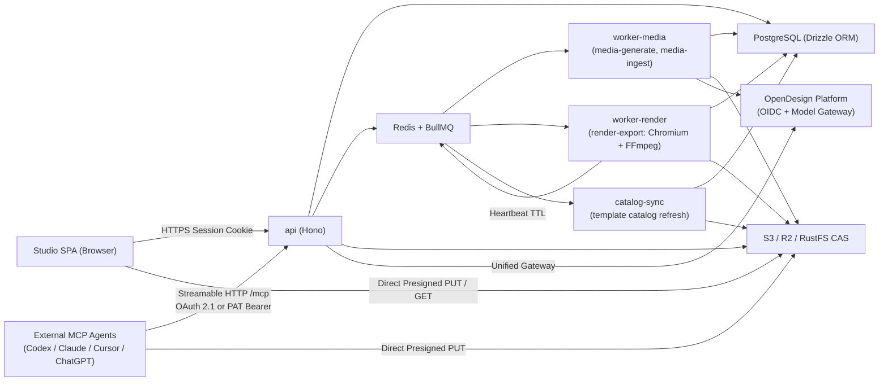

# OpenMotion Product Architecture

Updated: 2026-11-23. This document describes the container-first cloud architecture of OpenMotion (Phase 1 implementation and Phase 2 roadmap). Every capability marked **Implemented (Phase 1)** runs in this repository today; items marked **Planned (Phase 2)** return structured `501 FEATURE_DEFERRED_P2` responses from backend endpoints and are hidden in Cloud Phase 1 Studio via `CLOUD_P1_FEATURES` (`studio/src/utils/cloudFeatures.ts`) with safe route redirects.

Related references: [Documentation index](../README.md) · [Discovery site map](discovery-site-map.md) · [Public MCP Phase 1 contract](../mcp-phase1-tools.md) · [Skill routing](../skills.md) · [Shared design system](../design-system.md) · [Template repository workflow](../template-repository.md) · [Deployment guide](../../deploy/README.md) · [Migration guide](../repository-migration.md).

---

## 1. Product Positioning & Core User Flows

**OpenMotion is a unified, cloud-native workspace for editable AI video and motion production.** Creators can start from **Explore** (curated templates, community showcases, media scenes, and motion Skills), work visually in **Motion Editor** (timeline, compositions, captions, properties, preview, and async MP4 export), manage generated or uploaded media in **Assets**, or drive the exact same workspace from any external MCP Agent over **Streamable HTTP (`/mcp`)**.

Core product principles:

1. **Agents and humans edit the same workspace.** Every project edit, asset import, model generation, version snapshot, and render export passes through shared domain services with optimistic revision protection (`expectedRevision` / `expectedVersionId`) and request deduplication (`requestId`).
2. **Container-first, diskless runtime.** Application pods hold no durable project state on local disk. Structured metadata lives in **PostgreSQL**, async queues and worker liveness live in **Redis / BullMQ**, and immutable project files, assets, and rendered videos live in **S3-compatible Content-Addressed Storage (CAS)**.
3. **One unified model gateway.** All image, video, speech, and music generation routes centrally through the **OpenDesign Model Gateway** tied to workspace identity and subscription entitlement—eliminating in-app BYOK secret forms, custom BaseURL inputs, and third-party key storage. Local Docker Compose supports `MODEL_GATEWAY_MODE=mock` for deterministic zero-billing development.
4. **Native Streamable HTTP MCP.** External Agents (Codex, Claude Code, Cursor, DeepSeek Harness, Claude Desktop, and ChatGPT Cloud on public HTTPS) connect directly to `/mcp` with **OAuth 2.1** or scoped **Personal Access Tokens (PAT)**—no host-side `docker exec` or local stdio bridge required.

### Primary Workspace Journeys

| Surface | URL Route | Capabilities |
| --- | --- | --- |
| **Explore** | `/` or `?page=explore` | Featured templates, highlights rail, Studio collections, model hubs, Skills index, and creators |
| **Motion Editor** | `?page=editor` / `?page=motion` | Diskless Hyperframes timeline & DOM editor backed by Postgres + S3 CAS, composition switcher, caption tracks, version history, remote-worker MP4 export |
| **Assets & Media Studios** | `/assets`, `/create/<scene>`, `/cinema`, `/sound` (and legacy `?page=assets`, `?page=cinema`, `?page=sound`, `?page=create&scene=<id>`) | Presigned S3 upload flow, unified OpenDesign Model Gateway generation (Image, Video, Audio), async job tracking, version inspection, zero-copy project import |
| **MCP · Connect Agent** | `/mcp-setup` (`?page=mcp`) | Product-wide capability handbook, Streamable HTTP `/mcp` setup (OAuth 2.1 + PAT), client-specific configs (including ChatGPT Cloud on HTTPS), copyable workflow prompts |
| **Settings** | `/settings/<id>` (`?page=settings&section=<id>`) | Account (OIDC sign-in/out, workspace switcher, PAT management, `AUTH_MODE=dev` banner), Subscription & usage, Default models, MCP · Connect Agent, General, Appearance, Privacy & data, Help, About |
| **Phase 2 / Gated Surfaces (Gated in Cloud P1)** | Design Studio, Game Studio, Workflows, Brand Kit, ASR Transcription, Review Comments, Local Agents, Settings Model Providers entry | Hidden in Cloud Phase 1 via `CLOUD_P1_FEATURES` (`studio/src/utils/cloudFeatures.ts`) with safe `replace` redirects (`/settings/providers` and `/settings/local` -> `/settings/models`, others -> `/explore`); deferred backend endpoints return `501 FEATURE_DEFERRED_P2` without crashing or blocking Phase 1 workflows |

---

## 2. Container-First Runtime Topology

OpenMotion compiles to a single backend codebase (`src/`) and one static Studio SPA bundle (`studio/build/`), deployed via workload-split process roles from a single container image (local Docker Compose via [`deploy/README.md`](../../deploy/README.md) or Kubernetes):

### Process Roles

| Role | Entrypoint / Mode | Responsibility | Scaling & Runtime Notes |
| --- | --- | --- | --- |
| **`api`** | Stateless Hono HTTP server (`src/entrypoints/api.ts`) | Serves Studio SPA, health probes (`/api/health/live`, `/api/health/ready`, `/api/health`), Auth (`/auth/*`), Account/Workspace/PAT APIs (`/motion-api/account/*`, `/motion-api/tokens`), Diskless Studio API (`/api/*`), Assets/Models/Projects/Exports APIs (`/motion-api/*`), OAuth 2.1 endpoints, and Streamable HTTP `/mcp` | Stateless, horizontally scalable; holds no persistent project files on disk |
| **`worker-media`** | BullMQ worker (`media-generate`, `media-ingest`) | Submits and polls OpenDesign Model Gateway jobs, verifies presigned S3 uploads and SSRF-checked HTTPS URLs, computes SHA-256 hashes, writes immutable CAS blobs and Postgres `assets` / `asset_versions` records | Network-I/O bound; independent concurrency from rendering |
| **`worker-render`** | BullMQ worker (`render-export`) | Hydrates a pinned project version from S3 CAS into ephemeral `/tmp` workspace, runs Hyperframes Chromium + FFmpeg rendering and technical verification, uploads MP4 back to S3 CAS, cleans up `/tmp`, and publishes liveness heartbeats (`ffmpeg`, `ffprobe`, `chromium`, active jobs) to Redis | CPU/memory intensive; isolated from API latency; Studio `/api/environment/ffmpeg` reads its live Redis heartbeat |
| **`catalog-sync`** | Scheduled / one-shot worker (`catalog-sync`) | Synchronizes published template catalog metadata and source manifests into Postgres & S3 | Runs independently without blocking request serving |

---

## 3. Data, Storage & State Boundaries

### PostgreSQL (Source of Truth for Metadata & Auth)

Managed with Drizzle ORM migrations (`src/db/schema/`):

- **Identity & Multi-Tenancy**: `users`, `workspaces`, `workspace_members` (roles: `owner`, `admin`, `editor`, `viewer`), `auth_sessions`, `personal_access_tokens` (prefix + SHA-256 hash, scopes, expiration, last-used, revocation), `oauth_clients`, `oauth_authorization_codes`, `oauth_tokens`.
- **Projects, Sessions & Revisions**: `sessions`, `session_messages`, `projects`, `work_rounds`, `project_files`, `project_versions`, `project_version_files`, `project_history_entries` (snapshots with monotonic `revision` and `currentVersionId`).
  - **High-Frequency Edit-Window Coalescing (Implemented P1)**: Studio sends its action label and edit-window ID with the write. Consecutive saves for the same coalescible action in that editor share a window. Rapid interactive Studio writes sharing this ID within `HISTORY_COALESCE_WINDOW_MS` (default `4000` ms) coalesce in-place into the current unpinned, non-export-referenced head `project_versions` row via delta upserts/deletes on only the changed `project_version_files` paths and exact sorted `sha256` CAS refcount deltas—eliminating PostgreSQL write amplification during timeline scrubbing and DOM dragging. Checkpoints, MCP/Agent edits, restores, pinned versions, redo-branch edits, edits exceeding `HISTORY_COALESCE_WINDOW_MS`, and any version referenced by an export/render `jobs` row always allocate a brand-new immutable snapshot.
  - **Immutable S3 Manifest Snapshots (Planned Phase 2 Scaling Path — Option ①)**: For ultra-large projects with thousands of files where even coalesced full-tree snapshots in `project_version_files` grow heavy, Phase 2 will store each version's complete file list as an immutable content-addressed `manifest.json` object in S3 CAS while keeping a single pointer row per version in PostgreSQL `project_versions`.
- **Assets, Blobs & Transfers**: `workspace_blobs` (including `metadata.previewProxy` for dual-track proxy metadata), `assets`, `asset_versions` (pinned version identities pointing to immutable CAS blobs), `upload_tickets` (time-bounded presigned staging state machine: `issued` -> `confirmed` -> `committed` / `failed`). Authoritative Mark-and-Sweep CAS GC verifies zero live references across `project_files`, `project_version_files`, `asset_versions`, and active `upload_tickets` with a 7-day grace window (`BLOB_GC_GRACE_SECONDS=604800`) and refcount drift reconciliation before physical deletion.
- **Async Jobs, Idempotency & Catalog**: unified `jobs`, `idempotency_receipts` (scoped deduplication for mutating `requestId` calls), `catalog_templates`, `catalog_template_files`.

### S3-Compatible Content-Addressed Storage (CAS)

Deploy the database migration and revision-aware API, media and render workers before enabling `TEXT_PATCH_WRITES` on the API. It defaults to false. When enabled, PostgreSQL stores small text replacements in `project_text_revisions`. Each revision names its immutable parent. S3 holds complete baselines and media. A patch save against an indexed baseline uses PostgreSQL, including the edit that schedules the next complete baseline. The media worker periodically claims due revisions from PostgreSQL using the existing BullMQ storage maintenance queue. Each worker rebuilds one file at a time. Failed or interrupted work becomes eligible again after one minute. Readers pin a version and replay its patches from the nearest completed baseline. On an older unindexed file the service may read its baseline once to check UTF-8 boundaries. Preview, project history, single-file downloads and ZIP exports all resolve the file version pinned by the project. See the [project editing contract](edit-core.md).

Studio can group successive edits into one HTTP request. Each completed edit retains its file preconditions and undo semantics. Peers receive committed changes in order over SSE and can update the mounted preview from the included file patches. Remote MCP commands use the same versioned project storage. See [ordered Studio writes](edit-core.md#ordered-studio-writes).

On a direct editor link, the cloud page starts the project file list and entry HTML as soon as the browser reads the page header. The Studio scripts and selected language load alongside those requests. If the authorized project open confirms the preloaded list's revision, the editor can use the list immediately. It checks the entry HTML against the file version in that list, not the project revision. The change subscription still checks for edits made during startup. A different or unknown head, a file event racing the handshake, or a stalled connection triggers a live read. Without a matching project open, the editor verifies the preload against the subscription head or reads the files again.

The file list provides paths and composition versions. Studio can show the clips and enable timeline edits from verified source while the preview loads its scripts, fonts and media. It requests font and asset details separately. On a switch between projects, the workspace keeps its existing project list and reads the status for the selected project.

When switching between isolated clip previews, Studio can keep the last painted player paused. Project events update resident file sources and the parked player. An unopened clip is read at its current version on first use.

For a standalone clip, the compiler can report the HTML files on which its preview depends. Studio keeps that player mounted when a peer edits another file outside the list. A template with startup scripts can declare reviewed dependencies, as shown in the [Welcome template](../../template-library/openmotion-welcome/TEMPLATE.md#standalone-previews).

Environments already using patch writes upgrade in two releases with the existing `TEXT_PATCH_WRITES` setting. First apply migration 0005 and roll out the compatible readers and garbage collectors to every API, media worker and render worker. This release still produces complete baselines at the previous intervals. After that rollout is healthy, deploy the asynchronous writer and media worker. During either rollout every running process can read the versions being written. Once asynchronous writes have started, the compatible first release is the rollback floor for readers and garbage collectors.

- Immutable media blobs, project source files, version snapshots, derived preview proxies (`workspaces/{wid}/derived/{sha256}/proxy.{mp4,webp,m4a}`), and rendered MP4 artifacts are stored under content-addressed keys (`workspaces/{wid}/blobs/{sha256}` and `catalog/blobs/{sha256}` in `src/infra/storage.ts`, plus staging prefixes for presigned uploads and export artifacts).
- **Time-Window-Aligned Presigned GET Caching**: Immutable CAS objects align presigned GET signing timestamps to UTC buckets (`S3_PRESIGN_CACHE_WINDOW_SEC=3600`) with `immutable` response cache headers so browsers and CDNs reuse cached media across timeline seeks and reloads.
- **Direct browser & Agent transfers**: Clients never proxy large binary uploads through `api` memory. Uploads follow a 3-step presigned workflow:
  1. `POST /motion-api/assets/uploads/tickets` (or MCP `openmotion_import_assets` `action=prepare_upload`) returns `{ uploadId, uploadUrl, headers, expiresAt, maxBytes }`.
  2. Client executes `PUT <uploadUrl>` directly against object storage.
  3. `POST /motion-api/assets/uploads/:uploadId/confirm` (or MCP `upload_ticket`) enqueues `media-ingest` verification, promotes the verified blob into CAS, triggers non-blocking preview proxy generation (`video` 720p faststart short-GOP H.264, `image` WebP, uncompressed `audio` AAC), and commits the asset/project reference idempotently.

### Diskless Option B Studio API (`src/studio/`)

Studio's editor routes (`/api/projects/*`, `/api/projects/:id/files/*`, `/api/render/*`, `/api/environment/ffmpeg`) operate purely against Postgres + S3 CAS with zero local `MOTION_DATA_DIR` project filesystem dependencies:

- File reads/writes and DOM edits enforce optimistic revision locks and coalesce Studio writes from the same explicit edit window within `HISTORY_COALESCE_WINDOW_MS` while preserving immutable snapshots for checkpoints, restores, Agent edits, and exports.
- Live preview streams bundled project HTML/CSS/JS over `/api/projects/:id/preview*` and serves binary workspace media via dual-track proxy routing: when `workspace_blobs.metadata.previewProxy` is `ready` (unless `?original=1` or `?raw=1` is requested), `HEAD` answers directly from metadata and `GET` issues a `302` presigned redirect to the derived proxy with `X-OpenMotion-Media-Track: proxy`, falling back seamlessly to the original CAS blob (`X-OpenMotion-Media-Track: original`) while proxies are pending or absent. `worker-render` always hydrates original CAS blobs for final exports.
- `GET /api/environment/ffmpeg` reports `mode: 'remote-worker'` backed by live `worker-render` heartbeats in Redis (`useFfmpegStatus.ts` polls automatically while workers are starting or unavailable).

---

## 4. Authentication, Authorization & Multi-Tenancy

OpenMotion supports two explicit runtime authentication modes controlled by `AUTH_MODE`:

1. **`AUTH_MODE=oidc` (Production Cloud Default)**:
   - Browser Studio authenticates via **OpenDesign OIDC** (Authorization Code + PKCE: `GET /auth/login?returnTo=...`, OIDC callback with RFC 9207 `iss` verification, `POST /auth/logout`, `GET /auth/me`, `GET /motion-api/account/summary`). `OidcService` supports both asymmetric JWKS IdPs (`RS256`/`ES256`/`EdDSA`) and HS256 client-secret ID tokens (OpenDesign / Vela Better Auth OAuth Provider with `disableJwtPlugin: true`) without allowing JWT algorithm-confusion downgrades; Bearer JWT verification on `/mcp` and API routes remains strictly limited to asymmetric JWKS, while `MCP_OAUTH_MODE=proxy` issues OpenMotion's first-party OAuth 2.1 tokens to external MCP clients.
   - Browser sessions use host-only `HttpOnly` secure cookies on `APP_PUBLIC_ORIGIN` and support switching active workspace via `POST /motion-api/account/workspaces/switch`.
   - **Cookie-less Preview Subdomain Isolation (Implemented P1)**: Configuring `PREVIEW_PUBLIC_ORIGIN` (e.g. `https://preview.openmotion.example.com` via a dedicated Ingress host rule) isolates rendered project HTML/JS iframes onto a cookie-less origin so untrusted preview scripts can never execute credentialed same-origin `fetch()` calls against `/motion-api/*`, `/auth/*`, or `/mcp`. On the preview host, `api` ignores all session cookies, allows only read-only `GET`/`HEAD`/`OPTIONS` access to `/api/projects/:id/preview*`, `/api/runtime.js`, `/api/vendor/gsap/*`, `/api/vendor/browser-export.js`, `/api/fonts/*`, and `/api/health/live`, authenticates preview documents using short-lived project-scoped HS256 tokens minted on the main origin (`POST /api/projects/:id/preview-token`, TTL `PREVIEW_TOKEN_TTL_SEC=900`), applies `Content-Security-Policy: frame-ancestors 'self' <APP_PUBLIC_ORIGIN>;`, `Referrer-Policy: no-referrer`, and `X-Content-Type-Options: nosniff`, and rejects all other paths and methods with `403 PREVIEW_ORIGIN_ISOLATED`. Preview tokens are never accepted by `/motion-api/*`, `/auth/*`, `/oauth/*`, `/mcp`, or mutating endpoints. Studio requests an asset lease by sending `{"assetLease":true}` to the token endpoint. Relative URLs resolve through a project-scoped base on the preview origin. Sending `{"assetLease":"<lease>"}` refreshes its Redis TTL after checking the Studio session's project access, keeping already-loaded stylesheets, module imports and media usable in an open tab. Once the lease expires, Studio receives a new base and reconnects. Client-side Browser Export runs inside a dedicated hidden iframe on `PREVIEW_PUBLIC_ORIGIN` using the lazy-loaded `/api/vendor/browser-export.js` bundle and transfers only progress events and the validated MP4/WebM `ArrayBuffer` back to Studio over origin-checked `postMessage`. Ingress access logs should redact the `pt` query parameter and the credential segment after `/preview/~assets/`. Single-host local Docker Compose leaves `PREVIEW_PUBLIC_ORIGIN` unset for zero-friction development.
   - Workspace RBAC enforces `owner`, `admin`, `editor`, and `viewer` permissions across HTTP and MCP endpoints (for example, `PUT /motion-api/models/defaults` requires `admin` role + `workspace:admin` scope).
   - **External MCP `/mcp` Authentication**: Strictly accepts **OAuth 2.1 Bearer access tokens** (with RFC 9728 `/.well-known/oauth-protected-resource/mcp` discovery + PKCE + Dynamic Client Registration) or **Personal Access Tokens (`om_pat_*`)** managed in `Settings > Account`. **Browser session cookies are never accepted on `/mcp`.**
2. **`AUTH_MODE=dev` (Local Docker Compose Convenience Mode)**:
   - Bypasses interactive OIDC sign-in with a deterministic single local owner workspace and dev Bearer token for zero-friction local Docker Compose evaluation.
   - Studio surfaces an explicit **Local Dev Mode (`AUTH_MODE=dev`)** banner in Account Settings and a **Dev** badge in the account menu so development bypass state is never ambiguous.

---

## 5. Unified OpenDesign Model Gateway (No BYOK)

In the container-first cloud architecture, all third-party BYOK provider forms, local API-key storage, custom BaseURL settings, and multi-provider preset lists have been retired from Studio and backend services:

- **Single Platform Gateway (`src/services/model-gateway.ts`)**: All image, video, speech, and music generation calls route through the OpenDesign platform gateway (`/motion-api/models`, `/motion-api/models/catalog`, `/motion-api/models/status`, `/motion-api/models/defaults`, `/motion-api/models/generate`, `/motion-api/models/jobs/*`).
- **Workspace Entitlement & Defaults**: Model discovery surfaces workspace plan entitlement (`mediaEntitlement`) and billing status from OpenDesign without asking users to copy secrets into Studio or chat. Workspace admins configure default `image`, `video`, and `audio` models in Settings.
- **Local Mock Mode (`MODEL_GATEWAY_MODE=mock`)**: Returns deterministic local fixture assets (64×64 PNG, 1s MP4, 1s WAV) with zero external API calls or billing, indicated in Studio by a **Local Mock Model Gateway** banner in Settings.
- **Shared Semantics**: Studio generators and MCP tools (`openmotion_media_use`, `openmotion_assets_use`) share the same catalog, parameter schemas, job records, cancellation, and non-duplicating `resume` checks.

---

## 6. Public Streamable HTTP MCP Contract

OpenMotion exposes a **Streamable HTTP** MCP server at `/mcp` (`http://127.0.0.1:4173/mcp` in local Docker Compose; `https://<domain>/mcp` in cloud deployments).

- **22 Registered Domain Tools**: Phase 1 preserves all twenty-two registered `openmotion_*` tool names (eighteen video/workspace tools including the `openmotion_assets` compatibility alias, plus four `openmotion_design_*` tools retained for forward compatibility). Negotiated MCP Apps connections may additionally discover read-only presentation extensions.
- **3-Way Cloud `openmotion_import_assets`**: Local host paths (`sourcePath`) are unsupported in cloud containers. External Agents import assets via:
  1. **Presigned upload ticket** (`action=prepare_upload` -> direct HTTP PUT -> commit with `upload_ticket`),
  2. **SSRF-checked public HTTPS `url`** (validated and fetched by `worker-media`), or
  3. **Zero-copy `library_asset`** (`assetId` + `versionId` within the same workspace).
- **Client Support**: Works natively with Codex, Claude Code, Cursor, DeepSeek Harness, Claude Desktop, and **ChatGPT Cloud** (enabled automatically when deployed on a public HTTPS origin with OAuth 2.1).
- **MCP Handbook (`studio/src/motion/McpConnectionPage.tsx`, `mcpCapabilities.ts`, `shared/integration.ts`)**: Acts as the maintained product-wide capability and setup handbook, reading live discovery from `GET /motion-api/account/integration`, offering client-side downloadable Streamable HTTP configs, direct PAT management links, and localized guidance across all eleven UI languages (`en`, `zh-CN`, `ja`, `ko`, `de`, `fr`, `ru`, `es`, `pt-BR`, `it`, `tr`).

---

## 7. Shared Design System & Studio UI Contract

All Studio interface surfaces consume [`packages/design-system`](../../packages/design-system/README.md) and [`packages/open-design-ui`](../../packages/open-design-ui/README.md):

- **Single token source**: Semantic light/dark theme tokens in `tokens.json` with zero literal colors in feature CSS, enforced by `npm run design:check`.
- **Opaque solid UI materials**: Menus, popovers, dialogs, tooltips, and floating controls use solid theme surfaces with zero `backdrop-filter` or translucent glass overrides.
- **Floating Toast feedback**: All transient operation feedback (copy, save, upload, PAT create/revoke, workspace switch, sync, failure) uses `useToast` + `StudioToastViewport` without shifting document layout.
- **Shared ODUI controls**: New actions and range controls reuse `Button`, `IconButton`, and `Slider`, maintaining `packages/open-design-ui/registry.json` exercised consumers (`CaptionsPanel.tsx`, `TimelineCaptionActions.tsx`, `GenerationParameters.tsx`) and tightening `scripts/studio-native-controls.json` as legacy controls are retired.

### Retired Local-Only Desktop UI

The following host-local features from the legacy desktop runtime have been removed in Cloud Phase 1:

- Embedded desktop Chromium `WebBrowser` tab (`shared/browser`)
- Local Codex `AssetChat` / `AssetConversation` runner and `/motion-api/assets/conversations` polling
- Local CLI Agent scanner & host terminal launcher (`Local Agents` settings tab, `useLocalAgents`)
- In-app BYOK API-key inputs, custom provider BaseURL forms, and third-party provider preset registries

---

## 8. Capability Matrix: Phase 1 Implemented vs Phase 2 Planned

| Capability Area | Phase 1 Status | Backend / Storage Path | Studio & MCP Behavior |
| --- | --- | --- | --- |
| **Video Projects & Revision-Checked Edits** | **Implemented (P1)** | Postgres + S3 CAS + Diskless Studio API | Full create/read/edit/rename/duplicate/trash/restore/delete, `expectedRevision` / `expectedVersionId` guards, `requestId` deduplication |
| **Version History, Coalescing & Restoration** | **Implemented (P1)** | Postgres `project_versions` + delta coalescing (`4000`ms window) + S3 CAS | Paginated history, edit-window coalescing for rapid Studio drags with immutable export/checkpoint/MCP snapshots, safe restore-as-new-version (P2 scaling path: S3 `manifest.json` snapshots) |
| **Dual-Track Preview Proxy & Cache-Aligned CAS** | **Implemented (P1)** | `worker-media` derived proxies + `preview.ts` proxy/original tracks + UTC-window Presigned GET + Mark-and-Sweep GC (7d grace) | Smooth scrubbing via `X-OpenMotion-Media-Track: proxy` with transparent original fallback & `?original=1` bypass; `worker-render` always exports originals |
| **Asset Library & 3-Way Cloud Import** | **Implemented (P1)** | Presigned S3 PUT + `worker-media` (`media-ingest`) | Studio presigned upload (`POST /uploads/tickets` -> `PUT` -> `confirm`); MCP `upload_ticket`, HTTPS `url`, zero-copy `library_asset` |
| **Unified Media Generation (Image/Video/Audio)** | **Implemented (P1)** | OpenDesign Model Gateway (`opendesign` or `mock`) + `worker-media` | Live catalog, workspace defaults, async BullMQ jobs, cancel/resume, zero BYOK secrets |
| **Async MP4 Rendering & Technical Verification** | **Implemented (P1)** | `worker-render` (`render-export`) + Redis heartbeat + S3 CAS | Remote Chromium/FFmpeg render pipeline, `/api/environment/ffmpeg` worker status, presigned download |
| **Template Catalog & Production Skills** | **Implemented (P1)** | Postgres + S3 / `catalog-sync` + `skills/` | Shared discovery across Explore, Studio, and MCP tools/resources |
| **Auth, Workspaces, Preview Isolation, OAuth 2.1 & PAT** | **Implemented (P1)** | OpenDesign OIDC / `AUTH_MODE=dev` + Postgres + cookie-less `PREVIEW_PUBLIC_ORIGIN` | Browser OIDC + workspace switcher + PAT CRUD; isolated preview subdomain with scoped HS256 tokens (`403 PREVIEW_ORIGIN_ISOLATED`); `/mcp` OAuth 2.1 & PAT Bearer isolation |
| **Manual Captions & SRT/VTT Import/Export** | **Implemented (P1)** | Project composition files + Studio Captions panel | Canvas aspect presets, CC toggle, manual cue edits, SRT/VTT import & export |
| **Cloud HTML Design Studio (`openmotion_design_*`)** | **Planned (Phase 2)** | Returns `501 FEATURE_DEFERRED_P2` | Tools remain registered in the 22-tool contract; Studio hides HTML Design Studio entries behind `CLOUD_P1_FEATURES.designStudio` (preserving the Image media studio) and redirects `/design*` to `/explore` |
| **Game Studio & Multi-Step Workflows** | **Planned (Phase 2)** | Returns `501 FEATURE_DEFERRED_P2` | Studio hides Game Studio (`CLOUD_P1_FEATURES.gameStudio`) and Workflows (`CLOUD_P1_FEATURES.workflows`), redirects `/studios/game` and `/scenarios*` to `/explore`, and Cloud Docker images exclude `templates/games` and `templates/game-kits` |
| **Brand Kit** | **Planned (Phase 2)** | `/motion-api/brand-kits/*` capture/import returns `501 FEATURE_DEFERRED_P2` | Studio hides Brand Kit entries behind `CLOUD_P1_FEATURES.brandKit` and redirects `/brand-kit*` to `/explore` (importing official catalog cards depends on the deferred capture/import backend) |
| **Cloud Speech Recognition (ASR Jobs)** | **Planned (Phase 2)** | Returns `501 FEATURE_DEFERRED_P2` | Studio hides the Transcript dock panel, `Open transcript` button, and `Auto captions` tab behind `CLOUD_P1_FEATURES.asr` while keeping manual captions, styling, and SRT/VTT import/export in Captions |
| **Frame-Anchored Review Comments & Markup** | **Planned (Phase 2)** | Returns `501 FEATURE_DEFERRED_P2` | Studio hides the Comments dock panel and player review controls behind `CLOUD_P1_FEATURES.reviewComments` and suppresses comment polling |
| **Live Real-Time Multi-User Co-Editing** | **Planned (Phase 2+)** | Not implemented in P1 | Phase 1 provides multi-user RBAC with optimistic revision conflict protection |

---

## 9. Verification Boundaries

Automated checks, containerized integration tests, live upstream billing, and human visual review remain distinct evidence tiers:

- **Static & Unit Gates**: `npm run typecheck:studio`, `npm run build:studio`, `npm run design:check`, `npm run test:studio`, `tests/mcp-onboarding.test.ts`, and `tests/cloud/*` verify contracts, schemas, RBAC, isolation, and UI resilience deterministically (using `MODEL_GATEWAY_MODE=mock` and mocked/containerized Postgres, Redis, and S3-compatible storage such as RustFS).
- **Container Stack Verification**: `docker compose up` validates end-to-end `api` + `worker-media` + `worker-render` + Postgres + Redis + RustFS (S3) health, presigned uploads, Streamable HTTP `/mcp`, and MP4 exports.
- **External Platform & Visual Acceptance**: Real OpenDesign OIDC sign-in, live paid OpenDesign Model Gateway execution, public HTTPS ChatGPT Cloud OAuth 2.1 handshakes, and human audiovisual review of rendered films require live environment credentials and human inspection.
